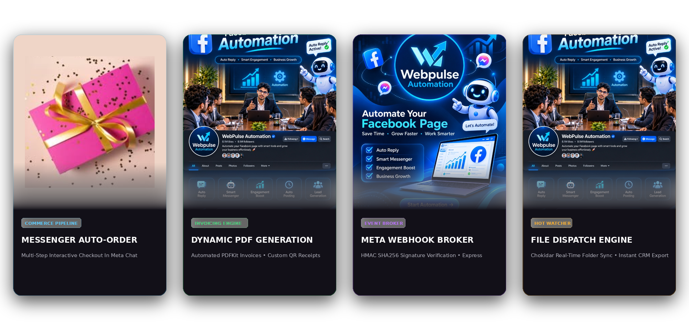

<div align="center">

# ⚡ WEBPULSE AUTOORDER — Social Commerce Order Pipeline
### Event-Driven Messenger Order Ingestion & PDF Invoice Engine Powered by Node.js & Chokidar

[](https://www.facebook.com/webpulseautomation)
[](https://nodejs.org/)
[](https://pdfkit.org/)
[](https://github.com/paulmillr/chokidar)
[](https://developers.facebook.com/)
[](LICENSE)

<br/>

**[⚡ View Official Platform Page](https://www.facebook.com/webpulseautomation)** &nbsp;•&nbsp; **[📦 GitHub Repository](https://github.com/labibfohayer/Webpulse-Page-Automation)**

<br/>



</div>

---

## 📌 Architectural Overview

**Webpulse AutoOrder Engine** is an event-driven e-commerce order ingestion, automated invoicing, and fulfillment pipeline. Engineered to bridge social commerce conversations on Facebook Messenger with physical order dispatch, the system automates customer intake, billing calculation, vector PDF invoice rendering, and CRM synchronization.

Built on **Node.js**, **Express**, and **Chokidar**, the pipeline eliminates manual human entry—transforming chat leads into verifiable invoices embedded with QR authentication codes in under 800 milliseconds.

---

## ⚡ Key Engineering Highlights

1. **Interactive Messenger Order Funnel:**
   - State-machine conversation flow guiding buyers through item selection, quantity adjustment, delivery address capture, and mobile payment verification.

2. **Automated Vector PDF Invoicing:**
   - Instant invoice compilation using **PDFKit**, embedding customer metadata, order itemization, cryptographic QR verification codes, and branded headers.

3. **Real-Time Filesystem Observer Daemon:**
   - Powered by **Chokidar**, continuously monitoring drop directories for external order JSON files, processing records asynchronously, and logging to sales ledgers.

4. **Live Telemetry & Web Dashboard:**
   - Real-time operations console utilizing Server-Sent Events (SSE) to visualize pipeline stages and fulfillment states.

---

## 🛠️ Tech Stack & Production Architecture

| Component | Technologies | Purpose |
| :--- | :--- | :--- |
| **Server Engine** | Node.js, Express, Meta Webhooks | Low-latency order payload ingestion and verification |
| **Invoicing Engine** | PDFKit, QRCode Generator | High-resolution commercial vector PDF generation |
| **Hot Watcher** | Chokidar File Daemon | Asynchronous incoming directory monitoring and archiving |
| **Live Telemetry** | Server-Sent Events (SSE), HTML5 Dashboard | Real-time multi-stage order tracking console |
| **Ledger Storage** | Persistent CSV & JSON Ledger Engines | Instant auditing and spreadsheet compatibility |

---

## 🚀 Getting Started & Local Development

```bash
# Clone the repository
git clone https://github.com/labibfohayer/Webpulse-Page-Automation.git
cd Webpulse-Page-Automation

# Install dependencies
npm install

# Start order engine
npm start
```

---

## 📄 License
This project is open-source and distributed under the [MIT License](LICENSE).
